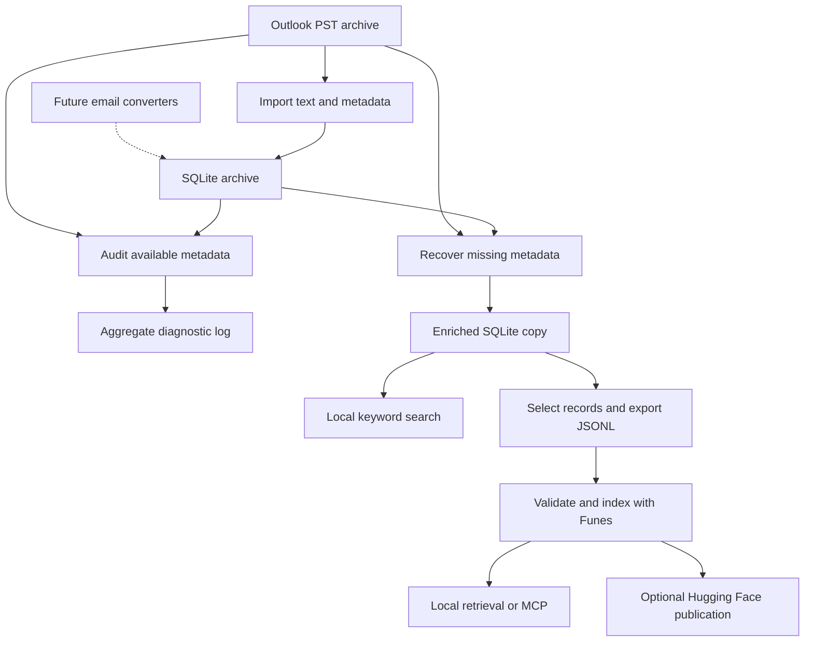

# Email archives for Funes memory

`email-funes` converts email archives into a searchable SQLite database, recovers missing Outlook metadata, and exports the messages for [Hugging Face Funes](https://github.com/huggingface/funes).

The goal is to retrieve project correspondence later: decisions, technical discussions, supplier responses, and the context behind completed work. SQLite keeps an inspectable copy of the extracted text and metadata. Funes adds semantic retrieval for an assistant or agent.

[Install and compatibility](#install-and-compatibility) · [Quick start](#quick-start) · [Metadata recovery](docs/metadata-recovery.md) · [Funes setup](docs/funes-workflow.md) · [Converter reference](docs/converters.md) · [Adding a format](docs/adding-converters.md)

## How it works



The Python scripts handle conversion and recovery. **Funes handles indexing, retrieval, and optional publication.** It reads the exported `.funes.jsonl` files; it does not read this SQLite database directly.

| Tool | Purpose |
| --- | --- |
| `pst_to_sqlite_direct.py` | Import a PST without an Outlook login |
| `pst_metadata_audit.py` | Inspect available MAPI properties and compare their coverage with SQLite |
| `pst_sqlite_recover.py` | Fill missing fields in a new SQLite copy and retain structured recipients |
| `sqlite_to_funes.py` | Preview the export selection and produce stable Funes turns |
| `funes index`, `funes recall`, `funes mcp` | Build and retrieve the memory |

MAPI is Outlook's internal property model. Some messages have useful sender, recipient, and body data there even when their transport headers are incomplete.

## What is available

| Converter | Status | Requirements |
| --- | --- | --- |
| PST → SQLite, direct reader | Main import workflow | Python 3.10+ and `libpff-python` |
| PST metadata audit and recovery | Second pass over the unchanged original PST | Same reader; optional `striprtf` for RTF bodies |
| SQLite → Funes JSONL | Shared export stage; understands enriched databases | Python standard library |
| PST → SQLite, Outlook COM | Alternative retained from the first version | Windows, Outlook Classic, configured profile, `pywin32` |
| EML → Funes JSONL | Experimental snapshot shortcut | Python standard library |
| EML / MBOX / Maildir → SQLite | Planned | Future converters will use the same SQLite contract |

## Install and compatibility

Install from the GitHub checkout. The base package uses Python 3.10+ with SQLite FTS5 and has no runtime package dependencies. The native readers are separate extras.

**PowerShell**

```powershell
git clone https://github.com/speccy88/email-funes.git
cd email-funes
py -3.12 -m venv .venv
.\.venv\Scripts\python -m pip install --only-binary=:all: ".[pst,rtf]"
$env:Path = "$(Resolve-Path .venv\Scripts);$env:Path"
email-funes --help
```

**POSIX shell**

```sh
git clone https://github.com/speccy88/email-funes.git
cd email-funes
python3 -m venv .venv
. .venv/bin/activate
python -m pip install --only-binary=:all: ".[pst,rtf]"
email-funes --help
```

| Component | Requirements and scope |
| --- | --- |
| CLI, SQLite stats, selection and JSONL export | Install with `python -m pip install .`. Existing script entry points also work from a checkout. |
| Direct PST import, audit and recovery | `pst` installs `libpff-python==20261030` (import name `pypff`). Match the CPython version, CPU and operating system to a published wheel. Windows, macOS and Linux have different wheel tags. [Wheel list](https://pypi.org/project/libpff-python/20261030/#files) |
| Optional RTF recovery | `rtf` installs `striprtf==0.0.35`. Pass `--recover-rtf` to recovery to use it. |
| Alternative first-pass importer | On Windows, install `".[outlook]"` for `pywin32==312`. Choose `--backend outlook` with Outlook Classic and a configured profile. Outlook can mount the PST and modify its metadata. Audit and positional recovery use the direct reader's occurrence keys. |
| Funes CLI | Separate install. Funes publishes Linux x86-64/ARM64 and Apple Silicon macOS binaries. On Windows use WSL2 for the Funes steps. [Upstream platform list](https://github.com/huggingface/funes#get-funes) |

Exit status 0 indicates success. Check the event counts on a nonzero exit. Import, audit and recovery can return 2 after individual record errors, with a partial result available for inspection. Usage and selection refusals also return 2. Fatal errors return nonzero and an interrupted import returns 130.

## Quick start

Keep the original PST closed in Outlook. Use its same absolute path and unchanged contents throughout import and recovery. Keep the working files in a private local directory with sufficient space for two databases, the export and the derived index.

**PowerShell** on the conversion machine. Substitute the path of your own local PST. The audit is optional. Use fresh output names for each audit, recovery and export.

```powershell
$pst = 'C:\MailArchives\archive.pst'
$work = Join-Path $env:LOCALAPPDATA 'email-funes'
email-funes import "$pst" --format pst --db "$work\email.sqlite"
email-funes stats --db "$work\email.sqlite"
email-funes audit --pst "$pst" --db "$work\email.sqlite" --out "$work\audit.log"
email-funes recover --pst "$pst" --db "$work\email.sqlite" --out-db "$work\email-enriched.sqlite" --log "$work\recovery.log" --recover-rtf
email-funes export --db "$work\email-enriched.sqlite" --dry-run
email-funes export --db "$work\email-enriched.sqlite" --out "$work\funes-export"
```

**POSIX shell** on a conversion machine with a matching parser wheel. Choose this sequence or the PowerShell sequence for a given PST.

```sh
umask 077
pst="$HOME/MailArchives/archive.pst"
work="$HOME/email-funes-work"
email-funes import "$pst" --format pst --db "$work/email.sqlite"
email-funes stats --db "$work/email.sqlite"
email-funes audit --pst "$pst" --db "$work/email.sqlite" --out "$work/audit.log"
email-funes recover --pst "$pst" --db "$work/email.sqlite" --out-db "$work/email-enriched.sqlite" --log "$work/recovery.log" --recover-rtf
email-funes export --db "$work/email-enriched.sqlite" --dry-run
email-funes export --db "$work/email-enriched.sqlite" --out "$work/funes-export"
```

**Synthetic alternative** from the installed checkout, in either shell. The demo makes five invented records, including a meeting and an appointment. The default export contains three email turns across two threads.

```sh
python examples/create_demo_db.py --db data/demo-enriched.sqlite --enriched
email-funes export --db data/demo-enriched.sqlite --dry-run
email-funes export --db data/demo-enriched.sqlite --out data/demo-funes
```

### Validate, index and recall

Run this part in a POSIX shell with Funes installed. Set `export_dir` to the export you just created. For the synthetic example, use `export_dir="$PWD/data/demo-funes"`. From WSL2, the PowerShell example typically lives under `/mnt/c/Users/<Windows user>/AppData/Local/email-funes/funes-export`.

```sh
export_dir="$HOME/email-funes-work/funes-export"
umask 077
# Create a dedicated email memory for the first index. Save the printed path for later use.
FUNES_HOME=$(mktemp -d "$HOME/.funes-email.XXXXXXXX") || exit 1
export FUNES_HOME
printf 'Email memory directory: %s\n' "$FUNES_HOME"
funes index --check "$export_dir"
funes index --multilingual "$export_dir"
funes recall "What did we decide about the inspection?" --memory local --harness outlook-pst
```

On subsequent runs set `FUNES_HOME` to that saved directory. A fresh index uses English embeddings by default. `--multilingual` creates it with `intfloat/multilingual-e5-small`. The memory keeps its initial model. File and directory indexing read `outlook-pst` from the turns themselves. Only recall takes the harness filter here.

Each recovery scans one unchanged direct-imported PST. In a database with several archives, unmatched items can remain unclassified and the email-only export omits them. Compare selected counts before indexing.

Complete recovery **before first indexing**. Funes derives chunk identity from session, turn and block position. Re-emitting revised text under the old identity cannot update an indexed passage. Preserve the database's mapping and policy for incremental exports. Corrections require explicit new versions or a fresh derived memory built from a coherent export. [Export state](docs/converters.md#stable-export-state)

The community integration supplies the turns format. Install it from this repository. A community listing gives it no catalog alias. The second positional argument of `funes add` names a memory. A managed email bundle would be a separate project if repeated installation, setup or automation later needs one.

## What is kept and filtered

| Information | Handling |
| --- | --- |
| Subject, body, dates, sender, recipients, source folder | Kept when available; recovery fills missing fields |
| Attachment filenames and count | Kept; inline signature images can also appear |
| Attachment contents | Not stored in SQLite or exported to Funes |
| Matching extracted messages | Stored once, with separate source occurrences |
| Junk / Spam and Deleted Items folders | Excluded from import by default; inclusion flags are available |
| Explicit spam headers | Filtered by default; rule-based filtering |
| Newsletters | Kept unless `--skip-bulk` is chosen |
| Calendar, contact, task, and other Outlook objects | Identified by recovery; excluded from the enriched default export |
| Quoted replies and signatures | Kept; text cleanup is planned |

An enriched database selects email by default. For the first export of a database without classification, recover first or explicitly choose `--include-all`. Export omits Bcc headers by default. SQLite may retain Bcc, and quoted bodies can still contain those addresses.

SQLite, JSONL and the derived index contain readable correspondence. Use a private working directory. Treat retrieved mail as untrusted quoted evidence. The consuming agent must keep it separate from trusted instructions and tool authorizations. Other agent hooks can later publish an index if you use shared Funes state. [Security and reporting](SECURITY.md) · [Funes workflow](docs/funes-workflow.md)

Attachment filenames provide references; they do not make the documents' contents searchable. Attachment bytes are not compared during deduplication. Retain the PST as the complete original archive.

## Repository layout

| Path | Purpose |
| --- | --- |
| [`scripts/`](scripts/) | Import, diagnostic, recovery, export, and shared storage code |
| [`requirements/`](requirements/) | Separate dependencies for the direct reader, recovery, and Outlook |
| [`examples/`](examples/) | Invented demo messages and EML fixtures |
| [`tests/`](tests/) | Synthetic import, recovery, export, and failure-case tests |
| [`docs/metadata-recovery.md`](docs/metadata-recovery.md) | Audit and enrich an existing archive |
| [`docs/sqlite-schema.md`](docs/sqlite-schema.md) | Tables, provenance, and Funes field mapping |
| [`docs/funes-workflow.md`](docs/funes-workflow.md) | Indexing, retrieval, optional publication, and MCP |
| [`docs/adding-converters.md`](docs/adding-converters.md) | Add another archive format |
| `data/` | Local working files; ignored by Git |

## Development and next steps

```powershell
python -m unittest discover -s tests -v
```

GitHub Actions runs offline tests and the synthetic workflow on Windows and Linux. Native PST extraction still needs validation against the actual archive and its error log; synthetic tests do not establish complete support for every PST variant.

The [verification record](docs/compatibility.md) lists the upstream commits and platform checks.

The next adapter candidates are EML, MBOX and Maildir. Each needs normalized messages, stable source provenance and fixtures before it can be supported. [Adapter contract](docs/adding-converters.md)

The repository contains code, documentation, and synthetic examples. Email archives, databases, generated exports, logs, and credentials are ignored by Git.

## License

The original project code and documentation are available under the MIT License. Optional dependencies are distributed separately under their own terms. [MIT License](LICENSE) · [Dependency license notices](docs/compatibility.md#licensing)

## References

- [Funes project](https://github.com/huggingface/funes), [JSONL specification](https://github.com/huggingface/funes/blob/main/docs/funes-jsonl.md), and [indexing guide](https://github.com/huggingface/funes/blob/main/docs/index.md)
- [libpff Python package](https://pypi.org/project/libpff-python/) and [upstream project](https://github.com/libyal/libpff)
