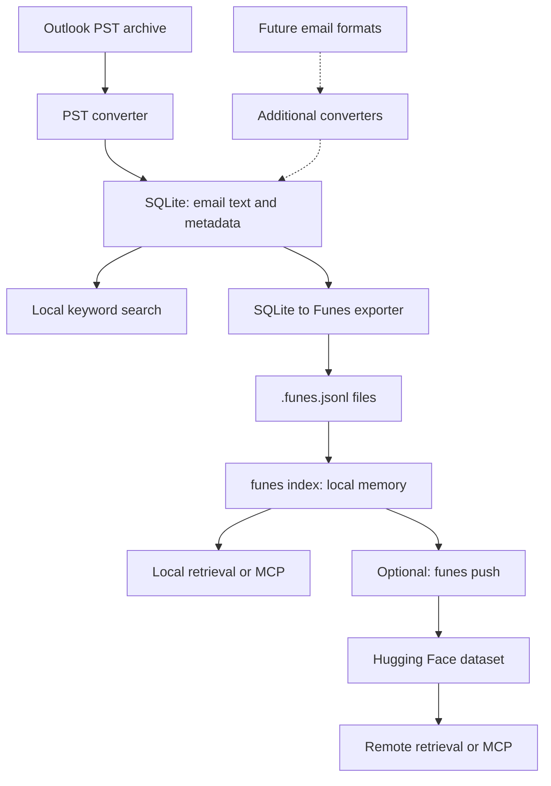

# Email archives for Funes memory

`email-funes` converts email archives into a searchable SQLite database, then exports the messages in the format used by [Hugging Face Funes](https://github.com/huggingface/funes).

The goal is to retrieve project correspondence later: decisions, technical discussions, supplier responses, and the context behind completed work. SQLite keeps a local, inspectable copy of the extracted text and metadata. Funes adds semantic retrieval for an assistant or agent.

[Quick start](#quick-start-pst-to-sqlite) · [Funes setup](docs/funes-workflow.md) · [Converters](docs/converters.md) · [Adding a format](docs/adding-converters.md) · [Troubleshooting](docs/troubleshooting.md)

## How it works



The Python scripts handle conversion. **Funes itself handles indexing, retrieval, and optional publication.** Funes does not read this SQLite database directly.

| Stage | Result | Tool |
| --- | --- | --- |
| Extract an archive | SQLite messages, metadata, source references, and search index | `pst_to_sqlite_direct.py` |
| Prepare conversations | One Funes turn per email, grouped into sessions where possible | `sqlite_to_funes.py` |
| Build local memory | Embedded, searchable email content | `funes index` |
| Retrieve context | Relevant correspondence for a question | `funes recall` or MCP |
| Share between machines, if wanted | A Funes memory in a Hugging Face dataset | `funes push` |

## What is available

| Converter | Status | Requirements |
| --- | --- | --- |
| PST → SQLite, direct reader | Main workflow | Python 3.10+ and `libpff-python` |
| PST → SQLite, Outlook COM | Alternative retained from the first version | Windows, Outlook Classic, configured profile, `pywin32` |
| SQLite → Funes JSONL | Shared export stage | Python standard library |
| EML → Funes JSONL | Experimental snapshot shortcut | Python standard library |
| EML / MBOX / Maildir → SQLite | Planned | Future converters will use the same SQLite contract |

This is a developing tool. Automated tests use synthetic messages and mocked PST readers; they do not establish complete extraction of every PST variant. See the [known limitations](docs/converters.md#known-limitations).

## Quick start: PST to SQLite

Run these commands in **PowerShell**, from the repository folder. Keep your PST outside the repository and close Outlook if it has that archive open.

### 1. Get the code and install the PST reader

```powershell
git clone https://github.com/speccy88/email-funes.git
cd email-funes
python -m pip install --only-binary=:all: -r requirements/pst.txt
python -c "import pypff; print(pypff.get_version())"
```

The package is **`libpff-python`**; its Python import name is **`pypff`**. The direct reader does not need an Outlook login. A compatible wheel must exist for your Python version and platform; [installation troubleshooting](docs/troubleshooting.md) covers this.

### 2. Import a small sample

Replace the PST path with your own:

```powershell
python scripts/pst_to_sqlite_direct.py --pst "C:\MailArchives\archive.pst" --db data/email.sqlite --limit 100
python scripts/pst_to_sqlite_direct.py --db data/email.sqlite --stats
python scripts/pst_to_sqlite_direct.py --db data/email.sqlite --search "motor OR inspection"
```

`--limit` counts inspected archive items, including those already imported or filtered. It does not select the newest emails. Inspect sample bodies, dates, and filenames before a full run.

### 3. Import the complete archive

Run the same command without `--limit`:

```powershell
python scripts/pst_to_sqlite_direct.py --pst "C:\MailArchives\archive.pst" --db data/email.sqlite
```

Completed source entries are skipped when you resume. Keep the source PST unchanged between runs. Errors are reported in an adjacent log; inspect that log before treating the conversion as complete.

### 4. Export a Funes snapshot

```powershell
python scripts/sqlite_to_funes.py --db data/email.sqlite --out data/funes-export
```

Use a **new or empty output folder** for each export, such as `data/funes-export-02` next time. The exporter keeps stable session, turn, and sequence assignments in SQLite. It stages a complete snapshot before making the JSONL folder available.

Prefer a synthetic example first? Follow the [demo](examples/README.md); it needs neither Outlook nor a PST file.

## Index and retrieve with Funes

Use a compatible **Linux, WSL2, or Apple Silicon macOS** environment with Funes installed. Copy the export folder there, or access it through `/mnt/c/...` under WSL2. The full [Funes guide](docs/funes-workflow.md) includes installation and paths.

```bash
# Keep the email index separate from your agent conversation memory.
export FUNES_HOME="$HOME/.funes-email"

funes index --check /path/to/funes-export
funes index --multilingual /path/to/funes-export
funes recall "What did we decide about the pump inspection?" --memory local --harness outlook-pst
```

Choose `--multilingual` on the first index for French and English correspondence. Use the same `FUNES_HOME` for subsequent commands.

## Optional: publish the memory to Hugging Face

Publication is a separate action. With the Hugging Face CLI authenticated and TruffleHog installed:

```bash
export FUNES_HOME="$HOME/.funes-email"
hf auth login
trufflehog --version
funes push YOUR_HF_USER/email-memory
funes recall "What did we decide about the pump inspection?" --memory YOUR_HF_USER/email-memory --harness outlook-pst
```

This uploads Funes' embedded memory, including email text. New datasets created by Funes are private by default; existing datasets keep their current visibility. Check the destination before confirming the first upload. See [publication and MCP access](docs/funes-workflow.md#5-optionally-publish-to-hugging-face).

## What is kept and filtered

| Information | Handling |
| --- | --- |
| Subject, body, dates, sender, recipients, source folder | Kept when available |
| Attachment filenames and count | Kept; inline signature images can also appear |
| Attachment contents | Not stored in SQLite or exported to Funes |
| Matching extracted messages | Stored once, with separate source occurrences |
| Junk / Spam and Deleted Items folders | Excluded by default; inclusion flags are available |
| Explicit spam headers | Filtered by default; this is rule-based, not a spam classifier |
| Newsletters | Kept unless `--skip-bulk` is chosen |
| Quoted replies and signatures | Kept; text cleanup is planned |

A filename is a reference, not the document's contents: an assistant cannot answer questions from a PDF that was excluded. Attachment payloads are not compared during deduplication. Retain the PST as the original archive.

## Repository layout

| Path | Purpose |
| --- | --- |
| [`scripts/`](scripts/) | Conversion commands and shared SQLite helpers |
| [`requirements/`](requirements/) | Separate dependencies for the direct PST and Outlook readers |
| [`examples/`](examples/) | Synthetic demo database generator and EML fixtures |
| [`tests/`](tests/) | Import, deduplication, export, and failure-case tests |
| [`docs/converters.md`](docs/converters.md) | Flags, behavior, and limitations of each converter |
| [`docs/sqlite-schema.md`](docs/sqlite-schema.md) | Storage contract and Funes field mapping |
| [`docs/funes-workflow.md`](docs/funes-workflow.md) | Local indexing, optional Hub publication, and MCP |
| [`docs/adding-converters.md`](docs/adding-converters.md) | How to add another archive format |
| [`docs/troubleshooting.md`](docs/troubleshooting.md) | Python, Outlook, missing metadata, and export issues |
| `data/` | Local working files; ignored by Git |

## Development and next steps

```powershell
python -m unittest discover -s tests -v
```

GitHub Actions runs the offline tests and synthetic workflow on Windows and Linux. No email archive or account credentials are needed.

Planned work: EML/MBOX/Maildir importers using SQLite, stronger thread reconstruction, optional body cleaning with the extracted original retained, better extraction reports, and controlled incremental synchronization. These are roadmap items, not current features.

Funes treats imported turns as append-only: editing text under an existing turn ID does not update indexed memory, and deleting a SQLite row does not delete its Funes history. Plan corrections as new versions or rebuild the derived memory. Keep the database and its `funes_map` table together.

Email archives, databases, exports, logs, and credentials are ignored by Git. The repository contains code and synthetic examples only. Use an authorized destination when publishing email content.

## References

- [Funes project and documentation](https://github.com/huggingface/funes)
- [Funes JSONL specification](https://github.com/huggingface/funes/blob/main/docs/funes-jsonl.md)
- [Funes publication behavior](https://github.com/huggingface/funes/blob/main/docs/push.md)
- [libpff Python package](https://pypi.org/project/libpff-python/) and [upstream project](https://github.com/libyal/libpff)
