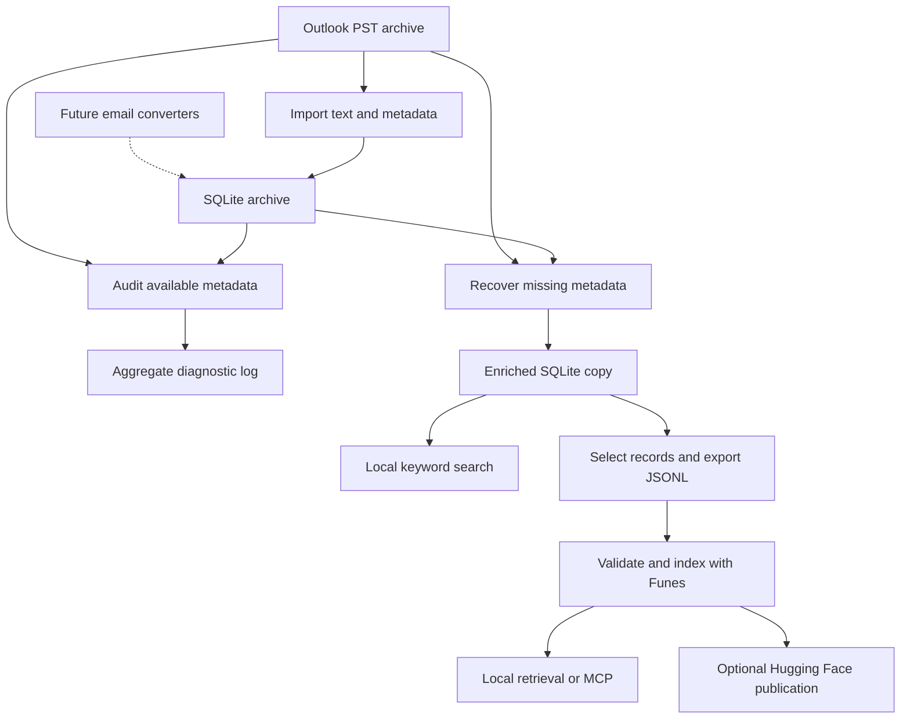

# Email archives for Funes memory

`email-funes` converts email archives into a searchable SQLite database, recovers missing Outlook metadata, and exports the messages for [Hugging Face Funes](https://github.com/huggingface/funes).

The goal is to retrieve project correspondence later: decisions, technical discussions, supplier responses, and the context behind completed work. SQLite keeps an inspectable copy of the extracted text and metadata. Funes adds semantic retrieval for an assistant or agent.

[Quick start](#quick-start-pst-to-sqlite) · [Metadata recovery](docs/metadata-recovery.md) · [Funes setup](docs/funes-workflow.md) · [Converter reference](docs/converters.md) · [Adding a format](docs/adding-converters.md)

## How it works



The Python scripts handle conversion and recovery. **Funes handles indexing, retrieval, and optional publication.** It reads the exported `.funes.jsonl` files; it does not read this SQLite database directly.

| Tool | Purpose |
| --- | --- |
| `pst_to_sqlite_direct.py` | Import a PST without an Outlook login |
| `pst_metadata_audit.py` | Inspect available MAPI properties and compare their coverage with SQLite |
| `pst_sqlite_recover.py` | Fill missing fields in a new SQLite copy and retain structured recipients |
| `sqlite_to_funes.py` | Preview the export selection and produce stable Funes turns |
| `funes index`, `funes recall`, `funes mcp` | Build and retrieve the memory |

MAPI is Outlook's internal property model. Some messages have useful sender, recipient, and body data there even when their transport headers are incomplete.

## What is available

| Converter | Status | Requirements |
| --- | --- | --- |
| PST → SQLite, direct reader | Main import workflow | Python 3.10+ and `libpff-python` |
| PST metadata audit and recovery | Second pass over the unchanged original PST | Same reader; optional `striprtf` for RTF bodies |
| SQLite → Funes JSONL | Shared export stage; understands enriched databases | Python standard library |
| PST → SQLite, Outlook COM | Alternative retained from the first version | Windows, Outlook Classic, configured profile, `pywin32` |
| EML → Funes JSONL | Experimental snapshot shortcut | Python standard library |
| EML / MBOX / Maildir → SQLite | Planned | Future converters will use the same SQLite contract |

## Quick start: PST to SQLite

Run these commands in **PowerShell**, from the repository folder. Keep the PST outside the repository and close Outlook if it has that archive open.

### 1. Get the code and install the reader

```powershell
git clone https://github.com/speccy88/email-funes.git
cd email-funes
python -m pip install --only-binary=:all: -r requirements/pst.txt
python -c "import pypff; print(pypff.get_version())"
```

The package is **`libpff-python`**; the import name is **`pypff`**. A compatible wheel must exist for your Python version and platform. See [installation troubleshooting](docs/troubleshooting.md).

### 2. Import a sample, then the complete archive

Replace the PST path with your own:

```powershell
python scripts/pst_to_sqlite_direct.py --pst "C:\MailArchives\archive.pst" --db data/email.sqlite --limit 100
python scripts/pst_to_sqlite_direct.py --db data/email.sqlite --stats
python scripts/pst_to_sqlite_direct.py --db data/email.sqlite --search "motor OR inspection"
```

Inspect sample bodies, dates, and filenames. Then run the same import without `--limit`:

```powershell
python scripts/pst_to_sqlite_direct.py --pst "C:\MailArchives\archive.pst" --db data/email.sqlite
```

Completed source entries are skipped. Keep the PST unchanged between runs. `--limit` counts inspected items, including previously imported and filtered items; it does not select the newest messages.

### 3. Check and recover missing metadata

The audit reads the PST and SQLite without modifying either. Its default sample covers each folder:

```powershell
python scripts/pst_metadata_audit.py --pst "C:\MailArchives\archive.pst" --db data/email.sqlite --out data/pst_metadata_audit.log
```

For recovery with optional RTF body decoding:

```powershell
python -m pip install --only-binary=:all: -r requirements/recovery.txt
python scripts/pst_sqlite_recover.py --pst "C:\MailArchives\archive.pst" --db data/email.sqlite --out-db data/email_enriched.sqlite --log data/pst_recovery.log --recover-rtf
```

Recovery writes a **new enriched copy** and an aggregate log. It fills blank fields, classifies Outlook items, and records To/Cc/Bcc recipients with their source metadata. Existing message identities and thread assignments stay stable. The output database must not already exist.

Use the same original PST path and unchanged archive as the first import: this workflow matches source occurrences by path, folder, and item position. The [recovery guide](docs/metadata-recovery.md) covers full audits, small recovery tests, unresolved fields, and moving work between Windows and Linux.

### 4. Preview and export the selected messages

Start with a read-only preview:

```powershell
python scripts/sqlite_to_funes.py --db data/email_enriched.sqlite --dry-run
```

Then create the export:

```powershell
python scripts/sqlite_to_funes.py --db data/email_enriched.sqlite --out data/funes-export
```

An enriched database exports **email records by default**. Add `--include-meetings` to include meeting messages, or `--include-all` to include every item category. Bcc recipients are omitted unless you choose `--include-bcc`. A database without recovery classification retains the earlier all-record export behavior and prints a notice.

Choose these options before the first export. The database retains both the export policy and stable turn assignments; later runs reject a conflicting policy. Use a **new or empty output folder** for each snapshot. See [export behavior](docs/converters.md#sqlite-to-funes) for details.

Prefer an example first? The [synthetic demo](examples/README.md) needs neither Outlook nor a PST file.

## Index and retrieve with Funes

Use Linux, WSL2, or Apple Silicon macOS with Funes installed. Copy the JSONL folder there, or access it through `/mnt/c/...` under WSL2. The [Funes guide](docs/funes-workflow.md) covers installation and paths.

```bash
export FUNES_HOME="$HOME/.funes-email"

funes index --check /path/to/funes-export
funes index --multilingual /path/to/funes-export
funes recall "What did we decide about the pump inspection?" --memory local --harness outlook-pst
```

Choose `--multilingual` on the first index for French and English correspondence. Keep the same `FUNES_HOME` for subsequent commands.

You can optionally publish the indexed memory to a Hugging Face **dataset** using `funes push YOUR_HF_USER/email-memory`. Publication includes email text and requires Hugging Face authentication and TruffleHog. See [publication and MCP access](docs/funes-workflow.md#5-optionally-publish-to-hugging-face).

## What is kept and filtered

| Information | Handling |
| --- | --- |
| Subject, body, dates, sender, recipients, source folder | Kept when available; recovery fills missing fields |
| Attachment filenames and count | Kept; inline signature images can also appear |
| Attachment contents | Not stored in SQLite or exported to Funes |
| Matching extracted messages | Stored once, with separate source occurrences |
| Junk / Spam and Deleted Items folders | Excluded from import by default; inclusion flags are available |
| Explicit spam headers | Filtered by default; rule-based filtering |
| Newsletters | Kept unless `--skip-bulk` is chosen |
| Calendar, contact, task, and other Outlook objects | Identified by recovery; excluded from the enriched default export |
| Quoted replies and signatures | Kept; text cleanup is planned |

Attachment filenames provide references; they do not make the documents' contents searchable. Attachment bytes are not compared during deduplication. Retain the PST as the complete original archive.

## Repository layout

| Path | Purpose |
| --- | --- |
| [`scripts/`](scripts/) | Import, diagnostic, recovery, export, and shared storage code |
| [`requirements/`](requirements/) | Separate dependencies for the direct reader, recovery, and Outlook |
| [`examples/`](examples/) | Invented demo messages and EML fixtures |
| [`tests/`](tests/) | Synthetic import, recovery, export, and failure-case tests |
| [`docs/metadata-recovery.md`](docs/metadata-recovery.md) | Audit and enrich an existing archive |
| [`docs/sqlite-schema.md`](docs/sqlite-schema.md) | Tables, provenance, and Funes field mapping |
| [`docs/funes-workflow.md`](docs/funes-workflow.md) | Indexing, retrieval, optional publication, and MCP |
| [`docs/adding-converters.md`](docs/adding-converters.md) | Add another archive format |
| `data/` | Local working files; ignored by Git |

## Development and next steps

```powershell
python -m unittest discover -s tests -v
```

GitHub Actions runs offline tests and the synthetic workflow on Windows and Linux. Native PST extraction still needs validation against the actual archive and its error log; synthetic tests do not establish complete support for every PST variant.

Planned work includes EML/MBOX/Maildir importers through SQLite, stronger thread reconstruction, optional body cleaning, and controlled incremental synchronization.

Funes uses stable turn identities. Editing text under an existing ID does not replace its indexed content, and deleting a SQLite row does not delete Funes history. Complete recovery before the first index; handle later corrections as explicit versions or a rebuild of the derived memory.

The repository contains code, documentation, and synthetic examples. Email archives, databases, generated exports, logs, and credentials are ignored by Git.

## References

- [Funes project](https://github.com/huggingface/funes), [JSONL specification](https://github.com/huggingface/funes/blob/main/docs/funes-jsonl.md), and [indexing guide](https://github.com/huggingface/funes/blob/main/docs/index.md)
- [libpff Python package](https://pypi.org/project/libpff-python/) and [upstream project](https://github.com/libyal/libpff)
