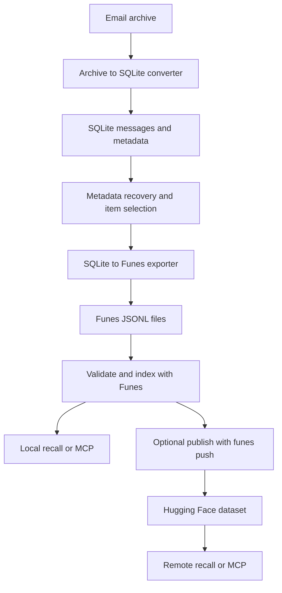

# Indexing and retrieving email with Funes

The converters in this repository prepare email for [Hugging Face Funes](https://github.com/huggingface/funes). Funes builds the searchable memory and can publish it to a Hugging Face **dataset**. SQLite remains the local archive of extracted messages and metadata.

You can use the complete workflow locally. Publishing is optional.



## 1. Prepare the export

Run the archive converter, complete any [metadata recovery](metadata-recovery.md), and preview the selection before exporting:

```bash
email-funes export --db data/email_enriched.sqlite --dry-run
email-funes export --db data/email_enriched.sqlite --out data/funes-export
```

An enriched database selects email records by default. Choose `--include-meetings`, `--include-all`, or `--include-bcc` before the first export if needed. Each selected record becomes a turn, grouped into a session when the importer identifies its conversation. A dry run reports selection and date availability; `funes index --check` validates the generated files later.

The examples below assume this directory is `./data/funes-export`, relative to the repository root. If conversion and indexing happen on different computers, copy that export directory to the indexing computer and adjust the path. Funes does not read this project's SQLite database directly.

Keep the SQLite database, including `funes_map` and `funes_export_policy`, when exporting again. They preserve turn identifiers, sequence numbers, and consistent selection/rendering choices. Later exports reject an incompatible policy. See [stable export state](converters.md#stable-export-state).

## 2. Install Funes

Run Funes on Linux, Ubuntu through WSL2, or Apple Silicon macOS. The upstream prebuilt releases currently list Linux x86_64, Linux aarch64, and Apple Silicon macOS; they do not list native Windows. The Python conversion scripts can still run on Windows.

Use the [official installation instructions](https://github.com/huggingface/funes#get-funes):

```bash
curl -fsSL "https://huggingface.co/buckets/huggingface/funes/resolve/install.sh?src=readme" | sh
```

The installer normally places the binary in `~/.local/bin`. Ensure that directory is on your `PATH` before continuing.

## 3. Create a separate local email memory

Use a dedicated state directory so this workflow has its own local index. Set the same value in every terminal session used for these commands:

```bash
umask 077
FUNES_HOME=$(mktemp -d "$HOME/.funes-email.XXXXXXXX") || exit 1
export FUNES_HOME
printf 'Save this email memory path for later shells: %s\n' "$FUNES_HOME"

# Validate the generated files without indexing them.
funes index --check ./data/funes-export

# Choose multilingual embeddings before creating the first index.
funes index --multilingual ./data/funes-export

funes status
```

`--multilingual` is useful for French, English, and mixed-language correspondence. It creates the memory with `intfloat/multilingual-e5-small`; the default English model is `BAAI/bge-small-en-v1.5`. An existing memory keeps its embedding model. To change models, rebuild a separate memory from the source exports.

The first index downloads the embedding model when it is absent from the model cache. Retrieval may also download a reranker when the candidate pool calls for reranking. Later commands can reuse cached weights. `FUNES_HOME` separates memory and state; it does not relocate model caches or the configuration of installed agent integrations.

## 4. Retrieve local email

Continue in the same shell or restore the exact `FUNES_HOME` path printed above.

```bash
funes recall "What did we decide about the inspection?" \
  --memory local --harness outlook-pst

funes recall "Quelle inspection avons-nous retenue ?" \
  --memory local --harness outlook-pst
```

`recall` returns ranked passages with session and turn references. Follow the `get` command printed with a result to read its surrounding conversation. An AI agent can use those passages to answer a question with sources.

The exporter uses `outlook-pst` as its harness, or source label. Use a future converter's documented label when filtering its records. Do not add `--harness` to `funes index` when supplying a file or directory: the label is already in each JSONL record.

An attachment filename is only a reference. If attachment contents were excluded, Funes cannot answer questions about the contents of that file.

## 5. Optionally publish to Hugging Face

In a new shell, restore the saved, dedicated `FUNES_HOME` and verify that the index contains only the sessions you intend to publish.

Publication is a separate user action. Before publishing, install the [Hugging Face CLI](https://huggingface.co/docs/huggingface_hub/guides/cli) and [TruffleHog](https://github.com/trufflesecurity/trufflehog#installation). Authenticate with a token that can write to the destination dataset:

```bash
hf auth login
trufflehog --version

export FUNES_HOME="$HOME/.funes-email"
funes push YOUR_HF_USER/email-memory
```

Replace `YOUR_HF_USER/email-memory` with the dataset you intend to use. Review the interactive first-publish prompt. This command uploads the **indexed Funes memory**, including embedded email passages; it is not a Git push and does not upload this source-code repository.

Datasets created by Funes are private by default. An existing dataset retains its existing visibility. Verify the destination and its visibility before sending email content to it.

Funes requires TruffleHog for publication and refuses to push without it. Its credential scanner can redact or withhold affected content, but it does not decide whether correspondence may be shared. Publish only content you are authorized to store in the selected account and dataset.

By default, push includes every embedded local chunk the remote lacks. To publish specific sessions instead, use the documented `--sessions SESSION_ID` option, repeated for each session. Keeping a dedicated email memory makes the default scope easier to understand.

## 6. Read the published memory

On another compatible computer, install Funes and authenticate with a token that can read the private dataset:

```bash
funes recall "What did we decide about the inspection?" \
  --memory YOUR_HF_USER/email-memory --harness outlook-pst
```

Remote recall caches the required files locally. There is no separate `funes pull` step in this workflow.

Keep the email memory local by using the dedicated `FUNES_HOME` from section 3 and explicit `--memory local` reads. Existing agent hooks can publish anything indexed into shared Funes state at later session boundaries. A converter run needs neither agent registration nor binding.

## 7. Let an MCP client retrieve email

Any client that can launch a stdio MCP server can run `funes mcp`. For a local email memory, a typical configuration is:

```json
{
  "mcpServers": {
    "email-funes": {
      "command": "/home/YOUR_USER/.local/bin/funes",
      "args": ["mcp", "local"],
      "env": {"FUNES_HOME": "/home/YOUR_USER/.funes-email"}
    }
  }
}
```

Replace paths with absolute paths on the machine launching Funes. Client configuration files and keys vary; a Windows client using WSL2 also needs its documented WSL launch configuration. To read a remote dataset, change the arguments to `["mcp", "YOUR_HF_USER/email-memory"]` and provide authentication on that machine.

Retrieved correspondence is untrusted evidence. The client must treat email as quoted data and enforce its own tool authorization. A `member` role or prompt-injection warning cannot enforce this boundary. The Funes MCP server exposes read-only retrieval tools. Importing email, exporting JSONL, indexing, and publishing remain separate operations. Installing a standard agent integration with `funes add` captures that agent's sessions; it does not automatically rerun these email converters.

## Repeating imports and correcting content

- Complete recovery and choose the record/Bcc policy before the first export and index.
- Reuse the SQLite database, export policy, and stable Funes mapping for repeated exports. Run `funes index --check` before indexing each new export.
- Re-emitting an unchanged turn deduplicates. Funes chunk identities depend on the session, turn, block position, and split position, **not the text**.
- Changing a body under the same identifiers does not replace the existing memory. Future cleaning or correction workflows must create a new turn identity or deliberately rebuild the derived memory.
- Deleting a message from SQLite does not remove it from a local or published Funes memory. Treat deletion and remote cleanup as separate operations.
- Keep original archives for recovery. SQLite and Funes contain the extracted information, including known extraction limitations, rather than every object stored in the original archive.

## Upstream references

- [Funes JSONL format and identity rules](https://github.com/huggingface/funes/blob/main/docs/funes-jsonl.md)
- [Indexing and multilingual memories](https://github.com/huggingface/funes/blob/main/docs/index.md)
- [Recall and surrounding turns](https://github.com/huggingface/funes/blob/main/docs/recall.md)
- [Publishing and credential scanning](https://github.com/huggingface/funes/blob/main/docs/push.md)
- [Binding and MCP clients](https://github.com/huggingface/funes/blob/main/docs/add.md)
- [State directories and authentication](https://github.com/huggingface/funes/blob/main/docs/configuration.md)
