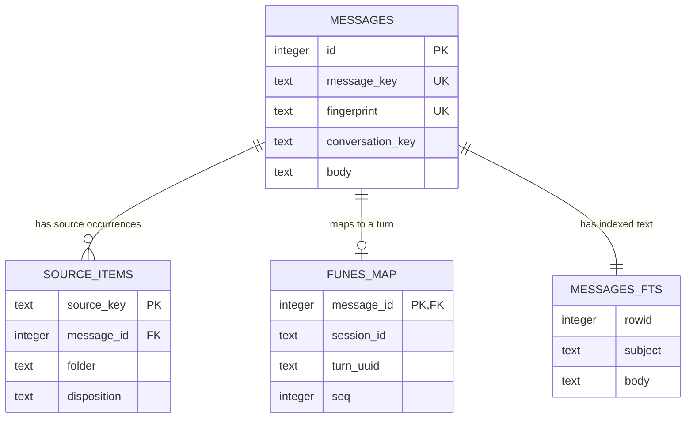

# SQLite storage and Funes mapping

SQLite is the shared intermediate format. It allows source-specific readers to evolve while keeping export and local keyword search separate from archive extraction. It stores extracted email text and metadata; the original archive remains the complete source.

## Tables

| Table | Grain and purpose |
| --- | --- |
| `messages` | One unique retained email representation |
| `source_items` | One imported source occurrence, linked to `messages.id` |
| `import_sources` | One direct-reader PST path with its size/mtime baseline |
| `messages_fts` | External-content FTS5 index of subject, body, sender name, and sender address |
| `funes_map` | One persistent Funes identity/sequence per email; created by the exporter |



`import_sources` is a separate resume guard, not a foreign-key relationship to messages. FTS5 is a virtual index, not an additional archive copy. Its internal SQLite shadow tables are implementation details.

## Email fields

| Fields in `messages` | Meaning |
| --- | --- |
| `id` | Local SQLite integer identifier |
| `message_key`, `fingerprint` | Stable extracted-message identity and conservative duplicate comparison |
| `internet_message_id` | Email Message-ID when present |
| `conversation_key` | Best available thread identifier; single-message fallback when needed |
| `sent_utc`, `received_utc` | UTC ISO timestamps with `Z`; nullable if unknown |
| `sender_name`, `sender_email` | Sender metadata; empty strings represent unavailable values |
| `to_list`, `cc_list` | Retained recipient text; not a normalized address table |
| `subject`, `body` | Subject and extracted plain text |
| `attachment_names_json` | JSON array of filename strings, including unavailable-name placeholders |
| `attachment_count` | Count reported by the reader |
| `first_folder` | First retained source folder; all imported occurrences are in `source_items` |

`source_items.disposition` is either `kept` or `duplicate`. The shared writer updates the message and FTS index together inside a savepoint; the importer controls outer batch commits. Editing `messages` directly does not automatically maintain FTS because there are no update/delete triggers.

## Mapping to Funes

| Funes field | Source |
| --- | --- |
| `format` | `1` |
| `session_id` | Frozen copy of `conversation_key` in `funes_map` |
| `turn_uuid` | Frozen copy of `message_key` in `funes_map` |
| `seq` | Dense, permanently assigned counter within a session |
| `ts` | Sent timestamp, otherwise received timestamp |
| `role` | `member` |
| `harness` | `outlook-pst` in the current exporter |
| `blocks` | One `text` block with sender, recipients, date, subject, folder, attachment filenames, and body |

Email metadata belongs inside the text block because the [Funes schema](https://github.com/huggingface/funes/blob/main/docs/funes-jsonl.md) rejects unknown JSON fields. The exporter omits `cwd`: a PST folder is not a real Git working directory.

Do not regenerate existing `funes_map` assignments, delete mapped rows, or reorder sequence values for a published memory. Late arrivals receive the next sequence number. Editing a body under an existing Funes turn ID does not replace its old indexed content. Treat corrections as explicit new versions or rebuild the derived memory from a fresh database/export.

## Useful queries

```sql
SELECT COUNT(*) AS unique_emails FROM messages;

SELECT disposition, COUNT(*) AS occurrences
FROM source_items GROUP BY disposition;

SELECT MIN(sent_utc) AS first_sent, MAX(sent_utc) AS last_sent
FROM messages;

SELECT SUM(body = '') AS missing_bodies,
       SUM(sender_email = '') AS missing_sender_addresses,
       SUM(to_list = '') AS missing_recipients
FROM messages;

SELECT m.id, m.sent_utc, m.subject
FROM messages_fts JOIN messages AS m ON m.id = messages_fts.rowid
WHERE messages_fts MATCH 'pump OR inspection';

PRAGMA quick_check;
PRAGMA foreign_key_check;
```

Close the importer before copying the database. SQLite uses WAL mode during import; copying only the main file while a writer is active can omit recent transactions. A proper SQLite backup operation is another option.
