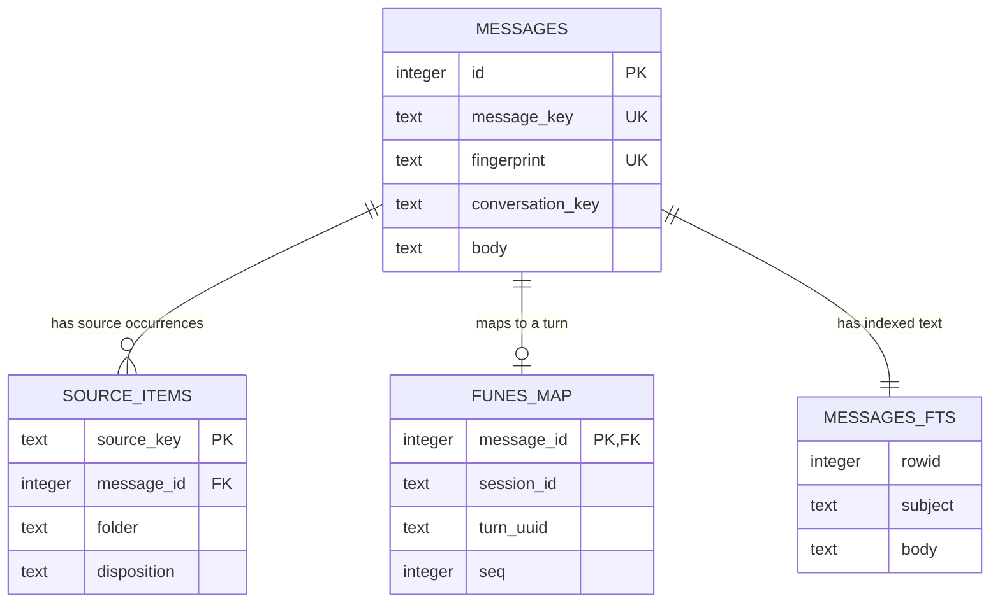

# SQLite storage and Funes mapping

SQLite is the shared intermediate format. It keeps source extraction, metadata recovery, local keyword search, and Funes export separate. It contains extracted text and metadata; the original archive remains the complete source.

## Core tables

| Table | Grain and purpose |
| --- | --- |
| `messages` | One unique retained representation; an Outlook archive can also contain non-email items |
| `source_items` | One imported source occurrence, linked to `messages.id` |
| `import_sources` | One direct-reader PST path with its size/mtime baseline |
| `messages_fts` | External-content FTS5 index of subject, body, sender name, and sender address |
| `funes_map` | One persistent Funes identity/sequence per selected record; created by the exporter |
| `funes_export_policy` | One stored selection and rendering policy for the mapping |



`import_sources` is a separate resume guard. FTS5 is a virtual index, and its internal shadow tables are implementation details. `funes_export_policy` is a singleton table; it does not map individual messages.

## Original message fields

| Fields in `messages` | Meaning |
| --- | --- |
| `id` | Local SQLite integer identifier |
| `message_key`, `fingerprint` | Stable extracted-message identity and conservative duplicate comparison |
| `internet_message_id` | Email Message-ID when present |
| `conversation_key` | Best available thread identifier; single-message fallback when needed |
| `sent_utc`, `received_utc` | UTC ISO timestamps with `Z`; nullable if unknown |
| `sender_name`, `sender_email` | Sender metadata; empty strings represent unavailable values |
| `to_list`, `cc_list` | Original or recovered recipient text |
| `subject`, `body` | Subject and extracted plain text |
| `attachment_names_json` | JSON array of filename strings, including unavailable-name placeholders |
| `attachment_count` | Count reported by the reader |
| `first_folder` | First retained source folder; all imported occurrences are in `source_items` |

`source_items.disposition` is `kept` or `duplicate`. The shared writer updates the message and FTS index inside a savepoint; the importer controls outer batch commits. Direct edits to `messages` do not automatically maintain FTS because there are no update/delete triggers. Recovery rebuilds the index after its updates.

## Recovery tables and provenance

These tables and columns are added by `pst_sqlite_recover.py` in the enriched copy. They are absent from a plain first-pass import.

| Added `messages` column | Meaning |
| --- | --- |
| `message_class` | Raw Outlook class, such as `IPM.Note` |
| `message_category` | Classification used for export selection |
| `sender_raw_address` | Native sender address before SMTP resolution |
| `sender_email_source` | Source of a newly recovered sender address |
| `recipient_to_source` | Source of a newly recovered flattened To list |
| `body_source` | Representation used to recover a previously empty body |

An empty provenance value can mean that the original field was already populated; it does not prove that the field was absent. Recovery only fills blank original values. Original fingerprints remain unchanged after enrichment.

| Category | Typical contents | Default enriched export |
| --- | --- | --- |
| `Email / IPM.Note` | Email messages, related templates, and delivery reports classified as email | Included |
| `Meeting request` | Meeting requests, responses, cancellations, and related meeting messages | With `--include-meetings` |
| `Appointment` | Calendar appointments | With `--include-all` |
| `Contact / distribution list` | Contacts and distribution lists | With `--include-all` |
| `Task`, `Note`, and other/unclassified values | Other Outlook objects or records without completed classification | With `--include-all` |

### `recovery_metadata`

One row per successfully enriched `messages.id`:

| Columns | Meaning |
| --- | --- |
| `message_id` | Primary key and foreign key to `messages.id` |
| `mapi_sender_raw`, `mapi_sender_smtp` | Retained sender address information from recovery |
| `represented_sender_smtp` | Separate represented/on-behalf-of SMTP identity |
| `display_to`, `display_cc`, `display_bcc` | MAPI display-recipient strings |
| `recovered_thread_key` | Candidate thread root for analysis; does not replace `conversation_key` |
| `recovered_internet_id` | Internet Message-ID recovered for a previously blank original field |
| `recipient_count` | Number of retained recipient rows for the item |

### `recovery_recipients`

One row per native recipient entry, keyed by `(message_id, ordinal)`:

| Column | Meaning |
| --- | --- |
| `message_id` | Foreign key to `messages.id` |
| `ordinal` | Position in the native recipient table |
| `recipient_type` | `to`, `cc`, `bcc`, or `unknown` |
| `display_name` | Recipient display name when available |
| `address_type` | Native type, such as `EX` or `SMTP` |
| `address_raw` | Original native address |
| `smtp_address` | SMTP value from native recipient properties or an already SMTP-form raw address |

A blank SMTP address is retained honestly. The exporter can render a name or raw internal address when SMTP is unavailable. It prefers structured rows for each recipient type; only an absent type falls back to the corresponding flattened field. An existing but empty typed row does not reinstate an older display list.

### `recovery_aliases`

One unambiguous Exchange internal address mapping:

| Column | Meaning |
| --- | --- |
| `exchange_address` | Normalized internal address; primary key |
| `smtp_address` | Unique SMTP value observed for that address |
| `evidence_count` | Number of successfully observed supporting property pairs, not distinct people or messages |

Ambiguous pairs are excluded. Resolution uses evidence in the archive; it makes no directory lookup.

## Mapping to Funes

| Funes field | Source |
| --- | --- |
| `format` | `1` |
| `session_id` | Frozen copy of `conversation_key` in `funes_map` |
| `turn_uuid` | Frozen copy of `message_key` in `funes_map` |
| `seq` | Dense, permanently assigned counter within a session |
| `ts` | Sent timestamp, otherwise received timestamp |
| `role` | `member` |
| `harness` | `outlook-pst` in the current exporter |
| `blocks` | One text block with participants, date, subject, source folder, available category, attachment filenames, and body |

Sender, recipient, and source metadata live inside the text block because the [Funes schema](https://github.com/huggingface/funes/blob/main/docs/funes-jsonl.md) rejects unknown JSON fields. Bcc appears only when enabled. The exporter omits `cwd`: a PST folder is not a Git working directory.

Selection is applied **before** assigning new sequences. Excluded Outlook objects do not create gaps. `funes_export_policy` contains `singleton = 1` and a canonical `policy_json` object with the format version, record selection, classification availability, recipient source, and Bcc choice.

Later exports must preserve that policy and the mapping. A late arrival receives the next sequence number. Editing text under an existing identity does not replace indexed content, and removing mapped records can create invalid gaps. Treat a changed selection or rendering strategy as a deliberate new derived export/index. See [export state and rebuilds](converters.md#stable-export-state).

Permanent sequences belong to the database that assigned them. Two independently built databases can contain different turns from the same email thread, each assigned `seq = 0`. The same message in both databases can also yield the same chunk identity and be deduplicated by Funes. Combining overlapping exports requires a shared mapping built before indexing, or separate memories. Comparing only filenames or producer labels cannot establish independence. See the [single-PST recovery limitation](converters.md#pst-metadata-audit-and-recovery) when planning a multi-archive import.

## Useful queries

These queries inspect counts without displaying private message content:

```sql
SELECT COUNT(*) AS retained_records FROM messages;

SELECT disposition, COUNT(*) AS occurrences
FROM source_items GROUP BY disposition;

SELECT MIN(sent_utc) AS first_sent, MAX(sent_utc) AS last_sent
FROM messages;

SELECT SUM(body = '') AS missing_bodies,
       SUM(sender_email = '') AS missing_sender_addresses,
       SUM(to_list = '') AS missing_recipients
FROM messages;

PRAGMA quick_check;
PRAGMA foreign_key_check;
```

On an enriched database:

```sql
SELECT message_category, COUNT(*) AS records
FROM messages GROUP BY message_category ORDER BY records DESC;

SELECT COUNT(*) AS enriched_records FROM recovery_metadata;

SELECT recipient_type, COUNT(*) AS recipients,
       SUM(smtp_address <> '') AS with_smtp
FROM recovery_recipients GROUP BY recipient_type;

SELECT SUM(body = '') AS emails_without_body
FROM messages WHERE message_category = 'Email / IPM.Note';
```

Close writers before copying the database. SQLite uses WAL mode during import; copying only the main file while a writer is active can omit recent transactions. A proper SQLite backup operation is another option.
